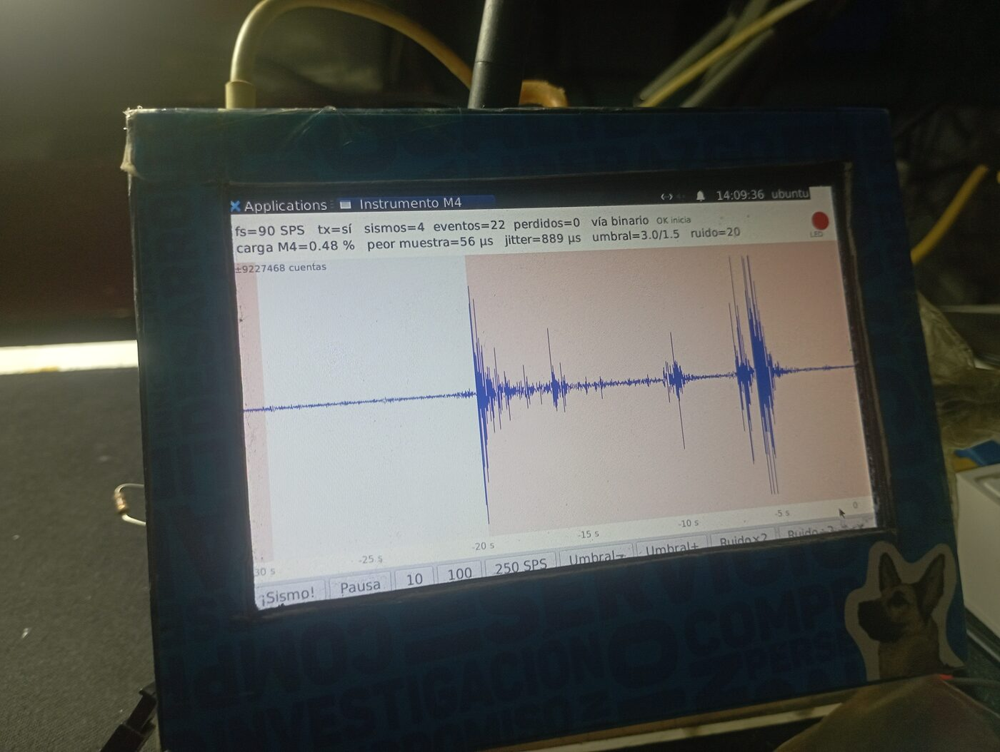
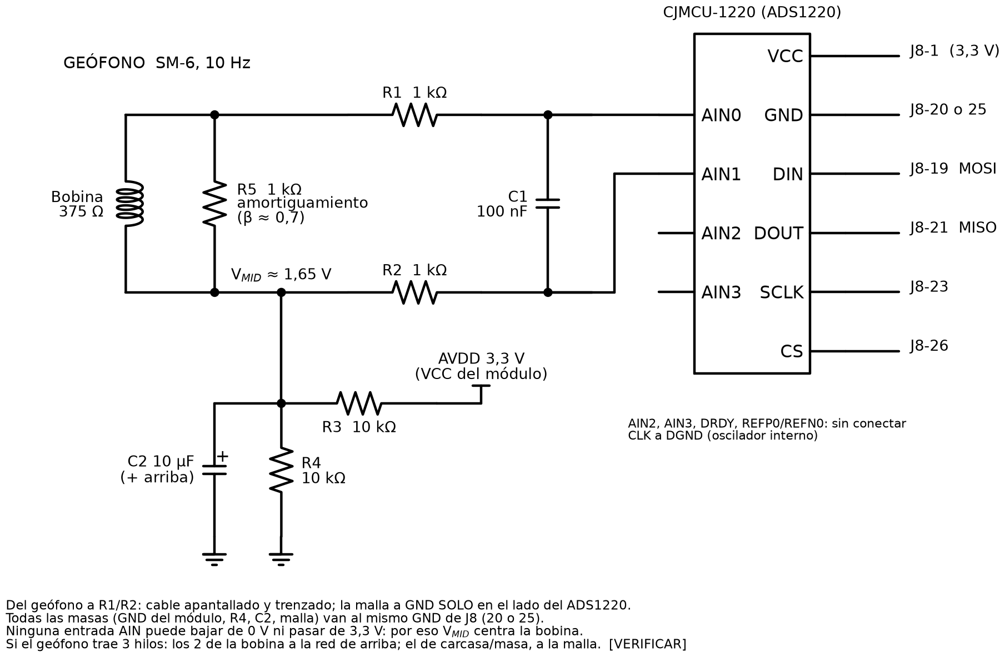
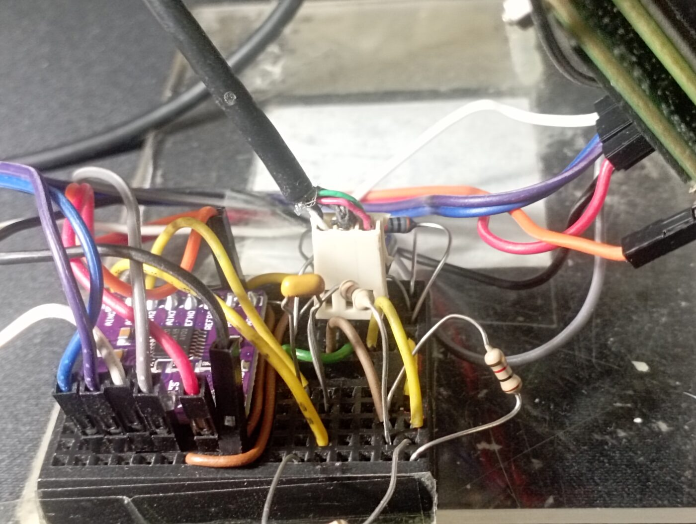
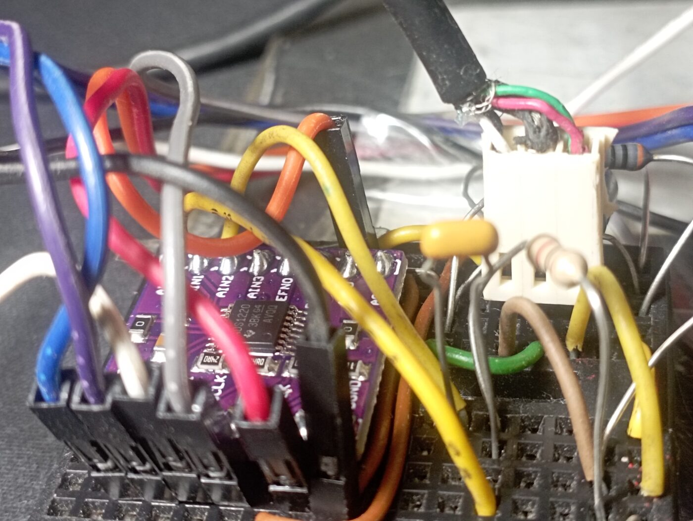
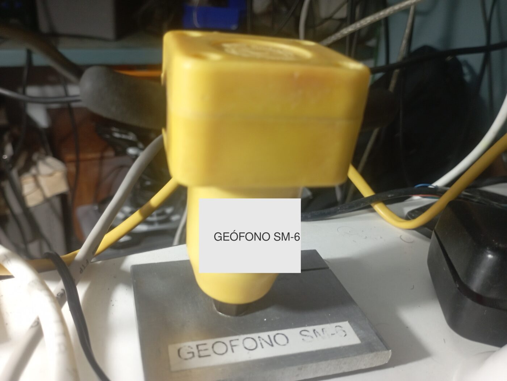
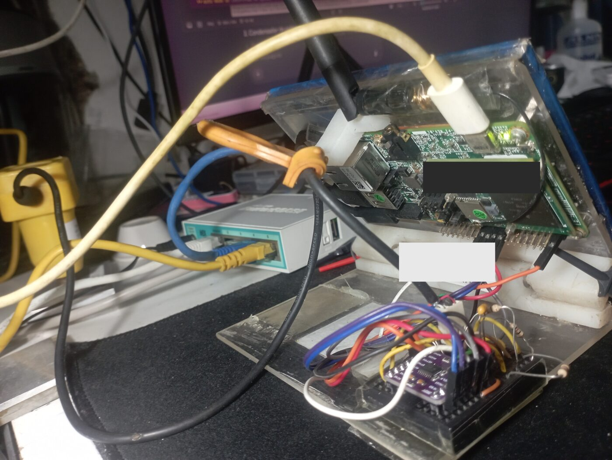

# TechNexion Pico-Pi-i.MX7D: guía práctica

Documentación, scripts y firmware para sacar partido a la **TechNexion
Pico-Pi-i.MX7D**, una placa con el SoC **NXP i.MX7 Dual**: dos Cortex-A7 que
corren Linux y **un Cortex-M4F en el mismo chip** que corre FreeRTOS.

Todo lo que hay aquí se hizo y se probó sobre una placa real, con el Ubuntu 22.04
y el kernel 5.10.72 que trae TechNexion. Es el complemento técnico del blog
[Compilando Pico-Pi i.MX7](https://compilando-pico-pi-imx7.blogspot.com).

## Tres niveles, nunca mezclados

- **documentado**: está escrito en un manual o en la bitácora;
- **compiló**: se generó el binario, sin errores;
- **verificado funcionando**: se ejecutó en la placa y se observó el resultado.

Que algo compile no prueba que funcione.

## Estado (2026-11-13)

| Pieza | Nivel |
|---|---|
| Firmware propio en el **M4**, cargado por U-Boot en cada arranque | ✅ verificado: LED a 100–1000 ms, ±1 ms medido desde Linux |
| **RPMsg** A7 ↔ M4 (`/dev/ttyRPMSG0`) | ✅ verificado: 104/104 ecos, mediana 4,9 ms. El kernel y el device tree de fábrica ya lo traían |
| RPMsg **binario** (`/dev/rpmsg0`, `rpmsg_char`) sobre el kernel de fábrica | ✅ verificado: solo hay que compilar dos módulos |
| **SPI (ECSPI3) desde el M4**, quitado a Linux en caliente | ✅ verificado: lazo interno 256/256 bytes; vuelve a Linux con `bind` |
| **ADC ADS1220** leído por el M4 | ✅ verificado: 20–600 SPS sin pérdidas; ruido en corto de 0,19 µV rms (×128, 90 SPS) |
| **Geófono** conectado al ADS1220 con una interfaz pasiva | ✅ verificado: golpes en el visor, reposo ~3,3 µm/s |
| **WiFi** BCM4339 (`wlan0`) | ✅ verificado: `brcmfmac.ko` compilado aquí y cargado **sobre el kernel de fábrica**, sin cambiarlo |
| **Punto de acceso** con DHCP y NAT a Internet | ✅ verificado: un teléfono navega a través de la placa; vuelve solo tras reiniciar |
| Red cableada con NetworkManager e IP de rescate que se autorrepara | ✅ verificado, incluido un arranque con el cable desconectado |
| Respaldo completo de la eMMC en caliente | ✅ verificado: imagen íntegra y `e2fsck` limpio |
| Temporizador **GPT3** desde el M4 | ❌ Linux apaga su reloj. Usar `vTaskDelay` (SysTick) |
| Demás ejemplos del M4 (`hello_world`, `pingpong`, `sema4`…) | ⚙️ compilaron; no probados en la placa |

## Por dónde empezar

| Quiero… | Lee |
|---|---|
| **usar el M4, RPMsg (texto y binario) y el SPI en mi propio proyecto**, paso a paso | [`docs/Guia_M4_RPMsg_SPI.md`](docs/Guia_M4_RPMsg_SPI.md) |
| conocer la placa: pines de J8, buses, qué periférico es de quién | [`docs/Tarjeta_Inventario.md`](docs/Tarjeta_Inventario.md) |
| cargar firmware en el M4 y comprobar que corre, **sin consola serie** | [`docs/M4_Despliegue_y_Verificacion.md`](docs/M4_Despliegue_y_Verificacion.md) |
| hablar entre Linux y el M4 por RPMsg | [`docs/RPMsg_Verificacion.md`](docs/RPMsg_Verificacion.md), [`docs/Seccion_README_RPMsg.md`](docs/Seccion_README_RPMsg.md) |
| usar el SPI desde el M4 y conectar un ADC | [`docs/SPI_M4_ECSPI3.md`](docs/SPI_M4_ECSPI3.md) |
| ver un proyecto completo: el M4 adquiere, Linux analiza | [`docs/M4_Instrumento_Bitacora.md`](docs/M4_Instrumento_Bitacora.md), [`a7/`](a7/LEEME.md) |
| instalar ya compilados `rpmsg_char`, `rpmsg_ctrl` y el `imx_rpmsg_tty` sin volcado al log | [`kernel/modulos/`](kernel/modulos/LEEME.md) |
| compilar el kernel o módulos compatibles con el de fábrica | [`docs/Kernel_Recompilacion.md`](docs/Kernel_Recompilacion.md), [`blog/…Compilacion_Kernel_y_M4.html`](blog/) |
| activar el WiFi y montar un punto de acceso | [`docs/WiFi_Diagnostico.md`](docs/WiFi_Diagnostico.md) |
| poner al día el Ubuntu de la placa | [`docs/Ruta_Actualizacion_SO.md`](docs/Ruta_Actualizacion_SO.md) |
| cambiar la red sin perder el acceso remoto | [`docs/Red_Migracion_NetworkManager.md`](docs/Red_Migracion_NetworkManager.md) |

Los documentos de `docs/` son **bitácoras fechadas**. Si dos discrepan, manda la
entrada más reciente.

## Un ejemplo completo: el M4 como instrumento

El M4 lee un ADC sigma-delta **ADS1220** por SPI, marca el ritmo de muestreo,
detecta eventos con STA/LTA y manda bloques binarios a Linux por RPMsg. Linux
dibuja la traza en la pantalla de la placa y le da órdenes al M4. Si Linux se
carga o se cuelga, la adquisición no se resiente. En la foto, un **geófono SM-6**
de 10 Hz conectado directo al ADC, con una interfaz pasiva de seis componentes:

| | |
|---|---|
|  |  |
|  |  |

Conexión a J8: **MOSI 19, MISO 21, SCLK 23, CS 26**, 3,3 V en el 1 y GND en el
20 o el 25. El esquema se genera con
[`docs/img/fuentes/geofono-ads1220-directo.py`](docs/img/fuentes/geofono-ads1220-directo.py)
(schemdraw); también está en [SVG](docs/img/geofono-ads1220-directo.svg).

Cómo se hizo, paso a paso y con las medidas:
[`docs/M4_Instrumento_Bitacora.md`](docs/M4_Instrumento_Bitacora.md). Por qué el
SPI del M4 no funcionaba en 2023 y cómo se comparte con Linux:
[`docs/SPI_M4_ECSPI3.md`](docs/SPI_M4_ECSPI3.md).

## Compilar el firmware del M4

    sudo apt install cmake            # Ubuntu 24.04 trae 3.28.3; CMake 4.x NO sirve
    # toolchain: GNU Arm Embedded 10.3-2021.10 descomprimido en ~/opt (ver blog/)
    git clone -b freertos_1.0.1_imx7d https://github.com/TechNexion/freertos-tn.git
    git -C freertos-tn checkout 3f714904420b9eca36d43ee3b2a3ebb629d02e93
    git -C freertos-tn apply ../bsp/freertos-tn-cambios-locales.patch
    ./scripts/build-m4.sh rpmsg/str_echo_freertos release clean

Detalle en [`bsp/LEEME.md`](bsp/LEEME.md). Los binarios ya compilados, con su
nivel de verificación, están en [`firmware-m4/`](firmware-m4/LEEME.md).

## Trampas que cuestan días

1. **La placa del BSP es `imx7d_pico_m4`**, no `imx7d_sdb_m4`. La equivocada
   enlaza sin quejarse y falla en silencio.
2. **En la FAT solo está el DTB `-m4`**: si U-Boot no encuentra el binario del M4
   que dice `m4image`, construye el nombre del DTB sin `-m4`, no lo encuentra y
   **Linux no arranca**. Sustituye el binario del M4; no lo borres.
3. **`disabled` en el device tree no significa «libre»**: los pads de ECSPI1 y
   ECSPI2 los usa el combo WiFi/Bluetooth.
4. **Linux gestiona los relojes de los periféricos**, aunque los use el M4 (caso
   GPT3).
5. **El RTC no tiene pila**: la hora depende de NTP al arrancar.
8. **El chip select de ECSPI3 sale por J8-26, no por el 24**, y **J8-36 y J8-11
   solo sirven de salida**: la placa base empuja esas líneas. Mídelo antes de
   fiarte de una tabla de pines.
9. **No leas registros del SoC con `/dev/mem` desde Linux**: una lectura del CCM
   colgó la placa.
6. **El `.txt` de calibración del WiFi es propio de cada placa** y no se
   descarga: guárdalo antes de reinstalar nada. El de esta placa está en
   [`kernel/`](kernel/).
7. **Sin consola serie, el SSH es el único acceso**: cualquier cambio de red se
   hace con la reversión automática armada (`systemd-run --on-active=…`).

## Contenido

    docs/          bitácoras técnicas fechadas; docs/img/ esquemas y fotos
    a7/            lado Linux del «instrumento»: visor GTK, órdenes al M4, pruebas del ADS1220
    blog/          entradas HTML del blog (WiFi+AP+RPMsg; compilación paso a paso)
    scripts/       env-m4.sh, build-m4.sh, build-kernel.sh
    firmware-m4/   binarios del M4 (.bin/.elf/.map) + SHA256SUMS + nivel de cada uno,
                   incluido el «instrumento» (v0.1 a v0.5)
    kernel/        .config de fábrica y con WiFi, Module.symvers, DTB, calibración WiFi
                   + modulos/: rpmsg_char, rpmsg_ctrl e imx_rpmsg_tty precompilados
    tarjeta/       ficheros de configuración instalados en la placa
    bsp/           cómo obtener el BSP de FreeRTOS + el parche (LED y firmware del instrumento)

Las direcciones IP y MAC de los documentos son **de ejemplo**.

## Hardware y software de referencia

TechNexion Pico-Pi-i.MX7D: SOM PICO-IMX7, 512 MB DDR3, eMMC de 3,6 GB, combo
WiFi/BT BCM4339 (AP6335), pantalla de 800×480. Ubuntu 22.04 de TechNexion,
kernel `5.10.72-g7966a667bd89-dirty` (`TechNexion/linux-tn-imx`, rama
`tn-imx_5.10.72_2.2.0-stable`), U-Boot 2021.04, BSP FreeRTOS 1.0.1
(`TechNexion/freertos-tn`).

## Licencia

Uso libre, **mencionando la fuente**:

- **Código y scripts**: [MIT](LICENSE). Conserva el aviso de copyright.
- **Documentación** (`docs/`, `blog/`, los README): [CC BY 4.0](LICENSE-docs).
  Cita el autor y el enlace a este repositorio.
- Los **binarios del M4** y los ficheros de `kernel/` conservan la licencia del
  software del que derivan (BSD-3-Clause de NXP, FreeRTOS con excepción GPL,
  GPL-2.0 del kernel): ver [`LICENCIAS-TERCEROS.md`](LICENCIAS-TERCEROS.md).

Cómo citarlo:

    rommeljose, «Pico-Pi-i.MX7D: guía práctica»,
    https://github.com/rommeljose/pico-pi-imx7d
