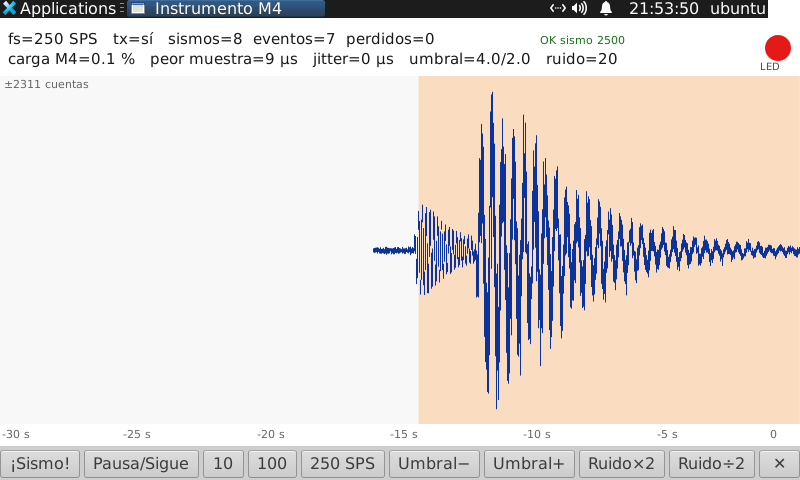
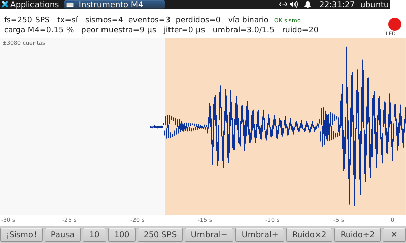

# Bitácora: el M4 como instrumento, Linux como analista

Proyecto para explotar la naturaleza **híbrida** de la Pico-Pi-i.MX7D: que el
trabajo continuo dependa del Cortex-M4 y que Linux, en el A7, analice, muestre y
comunique. RPMsg es el corazón del proyecto, no un accesorio.

Niveles, como en el resto del proyecto: **documentado**, **compiló**,
**verificado funcionando** (ejecutado en la placa y observado). En esta bitácora
se añade un cuarto, intermedio: **simulado en el PC**, cuando la lógica se probó
fuera de la placa.

### Estado a 2026-11-13

| Etapa | Estado |
|---|---|
| 0 — señal sintética, STA/LTA en el M4, visor | ✅ verificada (2026-11-12) |
| 1 — bloques binarios por `/dev/rpmsg0`, latido | ✅ verificada (2026-11-12) |
| 2 — ECSPI3 en el M4 y ADC real (**ADS1220**) | ✅ verificada (2026-11-13), con un **geófono SM-6** conectado directo. El visor elige la fuente y reparte el SPI (paso 5, en manual). Falta el rechazo de 50/60 Hz y una alimentación analógica propia |
| 3 — PPS de un GPS en el M4 | pendiente |
| 4 — varias placas en red | pendiente |

Firmware en la placa: **v0.5** (`firmware-m4/instrumento.bin`). Las versiones
anteriores están en la FAT y en `firmware-m4/`: `instrumento-e0` (v0.1),
`-e1` (v0.2), `-e2p2` (v0.3) y `-e2p4a` (v0.4).

---

## 2026-11-12 — Planteamiento

### Por qué se revisa la decisión anterior

Un documento de arquitectura anterior (no publicado aquí) decidió que Linux
adquiere y el M4 supervisa. Dos de sus argumentos ya no se sostienen:

- *«RPMsg completo es bastante más trabajo que todo lo hecho»* (§6.3): el kernel
  y el device tree de fábrica **ya lo traían**; RPMsg está verificado funcionando
  desde el 2026-11-11 (`RPMsg_Verificacion.md`).
- *«El M4 solo ha producido un LED parpadeando»*: hoy hay además un canal
  verificado en los dos sentidos (104/104 ecos).

El mismo documento reconocía tres ventajas del M4 (§5) que este proyecto busca:
**desacople** frente a un A7 saturado, **bajo consumo** con el A7 dormido, y la
arquitectura heterogénea como **objeto de investigación** en sí misma.

El objetivo no es que el M4 esté *ocupado*: es que el trabajo continuo **dependa
de él**, de modo que Linux pueda estar cargado, colgarse o dormir sin que ese
trabajo se resienta.

### Los cuatro puntos del planteamiento

```
   M4 (FreeRTOS, siempre activo)                Linux (A7)
 ┌─────────────────────────────────┐  RPMsg  ┌────────────────────────────┐
 │ lee el ADC en cada DRDY         │ ──────▶ │ dibuja la traza en vivo    │
 │ filtra y diezma                 │ bloques │ en la pantalla de 800×480  │
 │ detector STA/LTA → «¡evento!»   │ eventos │ guarda, analiza (FFT…)     │
 │ marca el tiempo de cada muestra │         │ red, AP, LoRa al exterior  │
 │ obedece órdenes                 │ ◀────── │ «tasa 100 SPS», «umbral 3» │
 └─────────────────────────────────┘ órdenes └────────────────────────────┘
```

1. **El M4 trabaja todo el tiempo**: adquiere, procesa y decide qué es un evento.
2. **RPMsg en los dos sentidos**: datos y eventos hacia Linux, órdenes hacia el M4.
3. **Visible en pantalla**: la traza en vivo, y la respuesta inmediata cuando se
   le cambia un parámetro.
4. **Sirve a una red de sensores**: Linux solo reenvía los eventos que el M4 ya
   detectó.

### Etapas

| Etapa | Qué se hace | Hardware nuevo |
|---|---|---|
| **0** | El M4 genera una **señal sintética** (seno, ruido, «sismos» falsos) y ejecuta todo el procesamiento; Linux la dibuja y le envía órdenes | ninguno |
| 1 | De `ttyRPMSG` (texto) a mensajes binarios con estructura (el «escalón 1» de aquel documento) | ninguno |
| 2 | Quitar **ECSPI3** a Linux y dárselo al M4. *Hecho en caliente (`unbind`), sin tocar el device tree; ADC: **ADS1220**, no el AD7705. Verificado el 2026-11-13, con geófono* | el ADC |
| 3 | Marca de tiempo con el **PPS** de un GPS, capturado en el M4 | módulo GPS |
| 4 | Varias placas detectan y envían eventos a una central | radio |

Si el M4 sabe procesar la señal sintética, conectar el ADC real solo cambia **de
dónde salen las muestras**.

### Riesgos conocidos

- **ECSPI3 en el M4 está solo documentado**, y el post del blog «SPI en el M4»
  dice «no se ha podido activar el hardware». La etapa 2 es la de más riesgo.
  *Superado el 2026-11-12 y 13: ver los pasos 2 a 4b de la etapa 2.*
- **Cambiar el device tree toca el único DTB de la FAT**
  (`imx7d-pico-pi-qca-m4.dtb`). Si falla, Linux no arranca: respaldo y plan de
  vuelta atrás antes. *Se evitó: ECSPI3 se suelta en caliente. El device tree
  solo se tocará cuando haya consola serie.*
- **El GPT queda fuera** para medir tiempo desde el M4 mientras Linux apague su
  reloj (`gpt3_root_clk enable_count=0`). Investigar si el M4 puede encenderlo o
  usar otro temporizador. En la etapa 0 se usa el contador de ciclos **DWT** del
  propio núcleo, que no depende de ningún reloj de periférico.
- **Sin consola UART6, depurar el M4 es a ciegas.** Un adaptador USB-serie de
  3,3 V ahorra mucho tiempo. Mientras tanto, el estado se observa por RPMsg y por
  el LED.

---

## 2026-11-12 — Etapa 0: firmware y visor

### Qué se hizo

**Firmware del M4**: `freertos-tn/examples/imx7d_pico_m4/demo_apps/instrumento/`.
Parte de `str_echo_freertos` (el eco RPMsg verificado) y del LED de
`blinking_imx_demo`. Dos tareas de FreeRTOS:

| Tarea | Prioridad | Qué hace |
|---|---|---|
| `adq` | alta (idle+3) | Cada `1000/fs` ms (`vTaskDelayUntil`, SysTick): genera una muestra, la pasa por el detector, la acumula en un bloque y lo deja en una cola. **Nunca espera a Linux**: si la cola está llena, cuenta el bloque como perdido y sigue |
| `com` | baja (idle+1) | Dueña única del canal RPMsg: envía lo que hay en la cola, lee órdenes sin bloquear y manda el estado cada segundo |

- **Señal**: ruido gaussiano + seno opcional + sismos con **fase P** (7 Hz, corta)
  y **fase S** (2,5 Hz, mayor y más larga) separadas 1,5–5 s. Sismos espontáneos
  cada 40–100 s, o a demanda.
- **Detector STA/LTA recursivo**: ventana corta 0,5 s, larga 10 s, media de 30 s;
  la LTA se congela durante el evento; disparo a 3,0 y cierre a 1,5 tras **3 s
  seguidos** por debajo (retención: P y S cuentan como un solo evento).
- **USER LED (GPIO2_IO06) encendido mientras dura un evento.** Lo enciende el M4,
  con o sin Linux escuchando. Linux lo **lee** en `/sys/class/gpio/gpio38/value`:
  es una comprobación independiente del protocolo.
- **Mide su propia carga** (‰ de ciclos en la tarea `adq`), el peor tiempo de una
  muestra y el **jitter** del periodo, con el contador de ciclos DWT.
- La adquisición arranca **antes** de que Linux cargue `imx_rpmsg_tty`. No
  transmite hasta recibir `inicia`, para no llenar un tty que nadie lee.

**Visor de Linux**: `a7/visor_instrumento.py`. GTK 3 + cairo, sin instalar nada
(la placa ya trae `python3-gi` y pycairo; **no** trae `tkinter`, ni numpy, ni
matplotlib). Traza de 30 s con los eventos sombreados, cabecera con el estado del
M4, el LED leído del GPIO y botones (`¡Sismo!`, pausa, 10/100/250 SPS, umbral,
ruido). Modo `--consola` para verificarlo por SSH.

### Protocolo (texto, una línea por mensaje RPMsg)

| Sentido | Línea | Significado |
|---|---|---|
| M4 → Linux | `H <nombre> <versión> fs=<fs>` | saludo |
| | `D <muestra> <fs> <v1> … <vn>` | bloque: índice de la primera muestra, fs y hasta 25 valores (~10 bloques/s) |
| | `E <muestra> <ratio×100>` | inicio de evento |
| | `F <muestra> <duración> <pico>` | fin de evento (duración en muestras) |
| | `S clave=valor …` | estado: parámetros, contadores, `carga_pm`, `peor_us`, `jitter_us`, `heap` |
| | `OK <orden>` / `ERR <orden>` | respuesta |
| Linux → M4 | `hola`, `estado`, `inicia`, `pausa` | |
| | `fs <Hz>` | 10–250, divisor de 1000 |
| | `ruido <cuentas>`, `amp <cuentas>`, `seno <cuentas> <mHz>` | señal |
| | `sismo [cuentas]`, `auto 0\|1` | sismo ya; sismos espontáneos sí/no |
| | `umbral <on×10> <off×10>` | p. ej. `umbral 30 15` |

Al cargarse `imx_rpmsg_tty`, Linux envía `hello world!` al M4 (está en el driver,
`drivers/rpmsg/imx_rpmsg_tty.c`); el firmware lo trata como `hola`.

⚠️ **El tty debe abrirse en modo crudo y sin eco** (`stty raw -echo`, o
`tty.setraw` en Python). Con el eco por defecto, el tty devolvería al M4 todo lo
que el M4 envía, como si fueran órdenes.

### Hallazgos de la compilación

- **`pdMS_TO_TICKS` no existe en FreeRTOS V8.0.0.** Con el tick a 1 kHz, 1 ms =
  1 tick; se define un sustituto.
- **La TCM de código es de 32 KB** (`m_text` 0x7DC0 + vectores 0x240). El primer
  enlace ocupó **31,2 KB**: quedaba 1,5 KB. Tres culpables, ninguno útil:
  - **`assert()` activos**: el BSP compila con `-D__NDEBUG`, que **no es**
    `NDEBUG`. El `assert` de `gpio_imx.c` arrastra el `__assert_func` de newlib →
    `fiprintf` → `vfprintf` → `malloc`. Se sustituye por uno propio, que además
    se ve: LED parpadeando rápido.
  - **`sinf` de libm** trae la reducción de argumento de precisión completa
    (`__kernel_rem_pio2f`, `two_over_pi`). Se sustituye por un seno propio (error
    < 1,6·10⁻⁴).
  - **Una división de 64 bits** (`__aeabi_uldivmod`) en el cálculo de la carga.

  Resultado: **21,5 KB** (`text` 21 004, `data` 544, `bss` 24 144). Quedan 11 KB.
- **`rpmsg_rtos_recv` copia siempre `maxlen` bytes**, no los `len` recibidos
  (`memcpy(data, msg.data, maxlen)` en `rpmsg_rtos.c`). El búfer de destino debe
  medir al menos `maxlen`.

### Prueba en el PC (nivel: simulado en el PC)

El mismo `instrumento.c` compila en el PC con `-DPRUEBA_HOST`
(`prueba_host.c`), con el generador y el detector reales:

    cc -O2 -Wall -DPRUEBA_HOST -o prueba prueba_host.c -lm && ./prueba

Una hora simulada en cada caso:

| fs | Sismos automáticos | Ruido | Sismos | Eventos |
|---|---|---|---|---|
| 100 | no | 20 | 0 | **0** (sin falsos disparos) |
| 100 | sí | 20 | 41 | **41** |
| 10 | sí | 20 | 38 | **38** |
| 250 | sí | 20 | 38 | **38** |
| 100 | sí | 200 | 39 | 18 (los pequeños quedan bajo el ruido: es la SNR, no un fallo) |

Sin la retención de 3 s salían 56 eventos para 41 sismos: el detector cerraba
entre la P y la S y la S volvía a dispararlo.

### Estado al terminar la compilación

| Pieza | Nivel |
|---|---|
| Firmware `instrumento.bin` (sha256 `d23114f7…bf57`) | **compiló** |
| Generador y detector | **simulado en el PC** |
| Visor `a7/visor_instrumento.py` | sintaxis comprobada |

---

## 2026-11-12 — Etapa 0: verificada en la placa

### Despliegue

Igual que `rpmsg_echo.bin` (`RPMsg_Verificacion.md`): `instrumento.bin` a la FAT,
`uEnv.txt` respaldado como **`uEnv.pre-instrumento`** y la línea cambiada a
`m4image=instrumento.bin`. Antes de reiniciar se comprobó que el fichero al que
apunta existe y su sha256 cuadra. `ubuntu` añadido al grupo **`dialout`** (el
tty es `root:dialout 660`). Reinicio verificado por `boot_id`.

**Vuelta atrás:** `sudo cp /mnt/boot/uEnv.pre-instrumento /mnt/boot/uEnv.txt` y
reiniciar (vuelve el eco RPMsg).

### Qué se observó (nivel: verificado funcionando)

Tras el arranque: GPIO 38 en `out` (el M4 corre) y `ttyRPMSG0` creado. Con
`visor_instrumento.py --consola`:

- `hola` → `H instrumento-sintetico 0.1 fs=100`; órdenes válidas → `OK`;
  `orden-inventada 1` y `fs 7` → `ERR`.
- `sismo 5000` → **`E` a los 90 ms**, LED encendido (leído en el GPIO); `F` a los
  19,9 s con pico 3973, LED apagado. Dos fuentes independientes coinciden: el
  protocolo y el pin.
- 35 s a 100 SPS: 339 bloques, **0 huecos, 0 perdidos**. 25 s a 250 SPS: 239
  bloques, 0 perdidos.
- Carga de la tarea `adq`: **0,1 %**; peor muestra **4 µs** a 100 SPS y **9 µs** a
  250 SPS; jitter **0 µs** (redondeado).



Visor en la pantalla de 800×480: sismo inyectado con `sismo 2500`, escrito
directamente en `/dev/ttyRPMSG0` desde otra sesión SSH mientras el visor lo tenía
abierto. Se ven la **fase P** (rápida y pequeña) y la **fase S**; el sombreado
empieza en la llegada de la P y el LED (círculo rojo) está encendido.

### Problema encontrado y corregido: el driver volcaba cada mensaje al log

`imx_rpmsg_tty.c` hace `print_hex_dump(KERN_DEBUG, …)` de **cada** mensaje
recibido. A ~10 mensajes/s, partidos en líneas de 16 bytes: **1583 líneas en
35 s**, guardadas por el journal **y** por rsyslog (`kern.log`, `syslog`) en la
eMMC. Del orden de cientos de MB al día.

Corrección: `print_hex_dump_debug(…)`, que sin `DEBUG` ni `DYNAMIC_DEBUG` no se
compila. Parche en
[`kernel/imx_rpmsg_tty-sin-volcado.patch`](../kernel/imx_rpmsg_tty-sin-volcado.patch);
original de la placa en `/root/imx_rpmsg_tty.ko.orig-20261112`. Módulo cargado en
caliente (`rmmod` + `modprobe`). **Verificado**: 25 s transmitiendo a 250 SPS →
**0 líneas nuevas** en `dmesg` y en el journal.

- Compilado **dentro del árbol** (`make drivers/rpmsg/imx_rpmsg_tty.ko`,
  `intree: Y`). La primera versión, con `make M=drivers/rpmsg`, se marcó como
  módulo externo y dejó el kernel *tainted* («loading out-of-tree module»); esa
  marca dura hasta el próximo reinicio.
- `vermagic` sigue con `-dirty`, igual que el kernel vivo: es lo que hace falta
  para que cargue.

### Hallazgos

- **Cambiar `fs` reinicia el detector**, que necesita 10 s de calentamiento: un
  `sismo` enviado justo después no se detecta. Es lo previsto, pero sorprende.
- **La carga del M4 es mínima** (0,1 %): generar y detectar a 250 SPS cuesta
  menos de 10 µs por muestra a 240 MHz. Para que el M4 «trabaje» de verdad hará
  falta más procesamiento (filtros, varios canales) o el ADC real. Con esta
  resolución (‰) la carga sale casi siempre 0: en la etapa 1, informarla en ppm.
- **El jitter que mide el M4 es relativo a su propio SysTick**: confirma que la
  tarea despierta puntual respecto a su reloj, **no** que ese reloj sea exacto.
  La exactitud absoluta es cosa de la etapa 3 (PPS).
- **El panel de XFCE se dibuja encima** de una ventana a pantalla completa y no
  reserva su franja (el área útil que informa GTK es la pantalla entera). El
  visor deja 26 px libres arriba.
- La placa **no trae `tkinter`**, ni numpy, ni matplotlib; sí `python3-gi`
  (GTK 3.24) y pycairo. Se descartó **KST2**: habría que instalar Qt y bibliotecas
  de KDE con apt, que en esta placa es una operación supervisada (~1,3 GB libres).

### Cómo se usa

    ~/visor.sh               # visor en la pantalla de la placa (display :0)
    ~/visor.sh parar         # lo cierra; el visor deja al M4 en «pausa»
    python3 ~/visor_instrumento.py --consola -s 30 "sismo 4000" "fs 250"

Al cerrar, el visor envía `pausa`: el M4 sigue adquiriendo y detectando (el LED
sigue funcionando), pero deja de transmitir a un tty que nadie lee.

### Estado

| Pieza | Nivel |
|---|---|
| Firmware `instrumento.bin` en el M4, cargado por U-Boot | ✅ **verificado funcionando** |
| Órdenes Linux → M4 y respuestas | ✅ **verificado funcionando** |
| Bloques de muestras y eventos M4 → Linux, sin pérdidas a 100 y 250 SPS | ✅ **verificado funcionando** |
| LED = evento, leído desde Linux | ✅ **verificado funcionando** |
| Visor gráfico en la pantalla de 800×480 | ✅ **verificado funcionando** (capturas de pantalla) |
| `imx_rpmsg_tty.ko` sin volcado al log | ✅ **verificado funcionando** |
| Botones del visor pulsados en la pantalla táctil | no probado (las órdenes se probaron por el tty) |
| Comportamiento tras reiniciar con el visor | no probado: el visor no arranca solo |

---

## 2026-11-12 — Prueba en la pantalla táctil y lanzador

- **Lanzador sin autoarranque** (a petición): icono «Instrumento M4» en el
  Escritorio (`~/Desktop/instrumento.desktop`, marcado de confianza con
  `metadata::xfce-exe-checksum`) y entrada en *Applications → Education*. Ambos
  ejecutan `~/visor.sh`. Icono: `a7/instrumento.svg`. XFCE pide doble clic, o
  doble toque.
- **Botones probados con el ratón y con el dedo por el usuario: funcionan**,
  salvo uno.
- **Fallo: «Pausa/Sigue» no reanudaba.** El botón elegía la orden según el campo
  `tx` del último `S`, pero **el M4 solo envía `S` mientras transmite**: tras la
  pausa no llegaba ninguno con `tx=0` y el botón volvía a mandar `pausa`.
  Corregido: el visor toma `tx` de la respuesta `OK pausa` / `OK inicia`, y el
  botón muestra «Pausa» o «Sigue» según el estado. Lógica comprobada; pendiente
  de que el usuario lo confirme en la pantalla.
- Observado en la pantalla: un sismo **sin sombrear** tras pulsar 250 SPS. Es el
  calentamiento de 10 s del detector después de cambiar `fs` (ver «Hallazgos»).
  Para la etapa 1: que el M4 informe de que el detector está calentando, y que el
  visor lo muestre.
- **«Pausa/Sigue» confirmado por el usuario en la pantalla.** Pero **al reanudar
  se borraba la traza**: el M4 sigue numerando muestras durante la pausa, el
  primer bloque llega con un salto de índice y el visor lo tomaba por pérdida y
  vaciaba la gráfica (y lo contaba en `huecos`). Corregido: cada muestra se guarda
  con su índice y **la pausa se comprime**. La traza anterior queda pegada a la
  nueva y la unión se marca con una línea discontinua gris («pausa N s»). Una
  pérdida real se marca en rojo («perdidas N») y es lo único que cuenta como
  hueco. Se eligió comprimir en vez de un eje de tiempo real porque con este, una
  pausa de más de 30 s volvería a sacar de la pantalla la traza anterior.
  **Verificado** en la pantalla (pausa de 8 s en medio de un sismo).

### Etapa 0: cerrada (2026-11-12)

Confirmado por el usuario en la pantalla táctil: botones, «Pausa/Sigue» y traza
conservada tras la pausa. **Etapa 0 verificada funcionando.**

---

## 2026-11-12 — Etapa 1, paso 1: `/dev/rpmsg0` sobre el kernel de fábrica

**Objetivo de la etapa 1**: mensajes binarios, con sus fronteras intactas, en vez
del texto del tty.

### El kernel vivo no traía `rpmsg_char`, pero sí lo esperaba

- `/proc/config.gz`: `# CONFIG_RPMSG_CHAR is not set`, `# CONFIG_RPMSG_CTRL is
  not set`. Ninguno de sus símbolos en `/proc/kallsyms`.
- Pero `virtio_rpmsg_bus` **ya crea** el dispositivo `virtio0.rpmsg_ctrl.0.0`
  (`modalias rpmsg:rpmsg_ctrl`) y se queda **sin driver**: falta solo el módulo.
- El árbol de compilación los tenía a `=y` porque `build-kernel.sh` los activa
  para la «vía B» (kernel completo nuevo). Para la placa hacen falta como `=m`.

### Compilados como módulos (nivel: verificado funcionando)

    scripts/config --module RPMSG_CHAR --module RPMSG_CTRL
    make olddefconfig && make -j$(nproc)          # 20 s, incremental

Respaldo previo de `.config` y `Module.symvers` en
el árbol del kernel. Config resultante y módulos guardados en un respaldo
local (`config-wifi-rpmsgchar-m-20261112`, `rpmsg_char.ko`, `rpmsg_ctrl.ko`);
cómo se compilan, en [`Seccion_README_RPMsg.md`](Seccion_README_RPMsg.md).

- `vermagic` idéntico al vivo, `intree: Y`; `rpmsg_ctrl` depende de `rpmsg_char`.
- **94/94 símbolos importados con el mismo CRC** que el kernel vivo.
- Instalados en `/lib/modules/…/kernel/drivers/rpmsg/` (ficheros nuevos, no
  sustituyen nada), `depmod -a`, `modprobe rpmsg_ctrl`: se enganchó al
  dispositivo huérfano y apareció **`/dev/rpmsg_ctrl0`**.
- Aún **no** se cargan al arrancar (falta añadir `rpmsg_ctrl` a
  `/etc/modules-load.d/rpmsg.conf`).

### Prueba: Linux → M4 por un endpoint nuevo

`RPMSG_CREATE_EPT_IOCTL` (`0x4028b501`) sobre `/dev/rpmsg_ctrl0` con
`{name="instrumento-bin", src=0x401, dst=0x0}` → aparece **`/dev/rpmsg0`**
(`/sys/class/rpmsg/rpmsg0/{name,src,dst}` = `instrumento-bin 1025 0`). Escribir
`hola\n` en `/dev/rpmsg0` → el M4 lo recibió y contestó
`H instrumento-sintetico 0.1 fs=250`… **por el tty**, porque el firmware de la
etapa 0 responde siempre a `canal->dst` (0x400, el tty). `RPMSG_DESTROY_EPT_IOCTL`
(`0xb502`) lo elimina limpiamente.

**Conclusión**: el camino Linux → M4 por `/dev/rpmsg0` funciona sobre el kernel
de fábrica. Para el camino de vuelta, el firmware debe responder a la dirección
**origen** de cada mensaje (1025), no a la del canal.

Otras observaciones: `dmesg` registró una caída de `eth0` de 2 s (a los 1776 s de
uptime, sin causa nuestra conocida) y un `edt_ft5x06 … error -6` del controlador
táctil. El kernel sigue *tainted* (4096 = módulo externo) por la carga con `M=`
de antes, hasta el próximo reinicio.

## 2026-11-12 — Etapa 1: bloques binarios por `/dev/rpmsg0` (verificado funcionando)

### Diseño (acordado antes de escribir código)

- **El tty se queda para lo legible**: órdenes, respuestas `OK`/`ERR`, `H`, `S`,
  y los eventos `E`/`F`.
- **Las muestras van en binario** por un endpoint propio que crea el visor con
  `/dev/rpmsg_ctrl0` (nombre `instrumento-bin`, `src` lo elige el kernel).
- **El M4 responde siempre a quien le escribió** (`dst_resp = src` mientras procesa
  cada mensaje). Es la trampa del paso 1.

**Formato del bloque**, little-endian, 12 B de cabecera más `n` × `int32`:

| Byte | Tipo | Campo |
|---|---|---|
| 0 | u8 | `0xB1` = bloque, formato 1. No es ASCII: un mensaje de texto nunca empieza así |
| 1 | u8 | `n`, número de muestras (hoy `fs/10`, como máximo 25: 10 bloques/s) |
| 2 | u8 | flags: bit 0 = evento activo, bit 1 = detector calentando |
| 3 | u8 | 0 |
| 4 | u16 | `fs` |
| 6 | u16 | `seq`: se numera **al crear** el bloque, aunque luego se pierda en la cola |
| 8 | u32 | índice de la primera muestra |
| 12 | i32[n] | muestras |

Python: `n, flags, fs, seq, ini = struct.unpack_from("<xBBxHHI", m)` y
`array("i", m[12:])`.

Con `seq` el visor ya no tiene que adivinar. Un salto de índice con `seq`
consecutivo es una **pausa**; si `seq` salta, es una **pérdida**. En la etapa 0
se deducía de la respuesta `OK pausa`.

**Órdenes nuevas**, que solo tienen sentido por el endpoint binario:

| Orden | Efecto |
|---|---|
| `bin` | alta en el binario (`dst_bin = src`) **y** latido. No responde: se repite cada 0,5 s |
| `bin 0` | baja: los bloques vuelven al tty en texto (`D …`). Responde `OK bin 0` |

**El latido existe por el log.** En este kernel, `msg received with no recipient`
es un `dev_warn` **sin limitar** (`virtio_rpmsg_bus.c:752`). Si el visor muere
sin decir `bin 0`, el endpoint desaparece y cada bloque enviado a esa dirección
deja una línea en el log. Con 2 s sin latido, el M4 vuelve al texto.

`S` incluye ahora `bin=<dirección suscrita, 0 si nadie>` y `carga_ppm` (antes
`carga_pm`, en ‰: a 100 SPS era siempre 1).

### Firmware v0.2

`instrumento.c`: `envia_bin()`, `dst_resp`/`dst_bin`/`ult_latido` en la tarea de
comunicación, y `seq`/`flags` en `msg_t`. 21 876 B, todo en TCM; solo los
avisos de siempre del BSP. La prueba en el PC da lo mismo que antes (41/41,
38/38, 38/38; 0 falsos en 1 h): el detector no se tocó.

La etapa 0 queda congelada en `firmware-m4/instrumento-e0.{bin,elf,map,c}` y en
la FAT como `instrumento-e0.bin`. Para volver a ella, copiarla sobre
`instrumento.bin`; no hay que cambiar `uEnv.txt`.

### Lado Linux

- `rpmsg_ctrl` añadido a `/etc/modules-load.d/rpmsg.conf`: se carga al arrancar
  (comprobado tras reiniciar).
- **Permisos.** `/etc/udev/rules.d/60-rpmsg.rules` da los `/dev/rpmsgN` al grupo
  `dialout`. **Pero no sirve para `/dev/rpmsg_ctrl0`**: ese nodo nace **sin
  clase** en sysfs (`SUBSYSTEM==""`, no hay enlace `subsystem`), y
  `udevadm test` falla con `Failed to clone sd_device object`. Lo arregla
  `rpmsg-permisos.service`, un oneshot que espera al nodo y le hace
  `chgrp dialout` y `chmod 0660`. Tras reiniciar: `crw-rw---- root dialout`.
- `visor_instrumento.py`: añade `CanalBin`, que crea el endpoint, envía el latido
  y lee cada mensaje con un `read()`. Si no hay `rpmsg_ctrl` o permisos, el visor
  sigue funcionando todo por el tty y lo dice en la cabecera. La cabecera muestra
  `vía binario` o `vía texto` y `calentando`.
- **Nodo huérfano.** Tras un `kill -9`, el endpoint muere al cerrarse el
  descriptor, pero **`/dev/rpmsg0` sigue existiendo**, y el siguiente visor
  creaba `/dev/rpmsg1`. Ahora el visor busca primero un nodo con su nombre y lo
  reutiliza. Al salir bien, lo destruye con `RPMSG_DESTROY_EPT_IOCTL`.

### Verificación en la tarjeta (tras reiniciar con el firmware nuevo)

| Prueba | Resultado |
|---|---|
| 12 s a 250 SPS, modo consola | 109 bloques, **todos binarios**, 0 huecos, `perdidos=0`, `bin=1025` |
| Salida limpia | `/dev/rpmsg0` destruido, **0** `no recipient` |
| `kill -9` del visor | **19** `no recipient` (unos 2 s × 10 bloques/s); después `bin=0` y el M4 vuelve al texto. El visor siguiente recupera el binario |
| Visor nuevo tras el `kill -9` | reutiliza `/dev/rpmsg0` y lo limpia al salir |
| `pausa` + `inicia` | `pausas 1`, `huecos 0`, ningún aviso nuevo en el log |
| Visor gráfico en pantalla | `vía binario`, sismo pedido sombreado, LED encendido; carga 0,15 %, peor muestra 9 µs, jitter 0 |



**Lo que queda abierto en la etapa 1:**

- Bloques mayores: el formato admite hasta 125 muestras (512 B), pero el firmware
  manda `fs/10`, como máximo 25. Ampliarlo cuesta memoria de la cola (quedan
  1,5 KB de heap).
- Llevar `E`/`F` también al binario, si algún consumidor lo necesita.
- El visor de la etapa 0 (`~/visor_instrumento-e0.py` en la tarjeta) sigue valiendo
  con este firmware: sin endpoint binario, todo llega en texto.

## 2026-11-12 — Etapa 2, paso 1: ECSPI3 hoy (reconocimiento, sin cambios)

Antes de empezar se hizo una **imagen completa de la eMMC**
(con `tarjeta/respaldo-emmc.sh`).

### Cómo tiene Linux ECSPI3 ahora mismo

| Qué | Estado |
|---|---|
| Nodo | `/soc/bus@30800000/spba-bus@30800000/spi@30840000`, `status=okay` |
| Driver | `spi_imx`, **compilado dentro del kernel** (no es módulo). Se puede desligar en caliente con `/sys/bus/platform/drivers/spi_imx/unbind` |
| Hijo | `spidev@0` (`rohm,dh2228fv`, 60 MHz máx.) → `/dev/spidev2.0`. Nadie lo abre |
| Chip select | **GPIO** `cs-gpios = <&gpio4 11 ACTIVE_LOW>` → gpio **107**, retenido por `spi2 CS0` |
| Pads | `ecspi3grp`: `I2C1_SCL`, `I2C1_SDA`, `I2C2_SCL` (en modo ECSPI3); `ecspi3_cs_grp`: `I2C2_SDA` (en modo GPIO, el CS) |
| Relojes | `ecspi3_src → cg → pre_div → post_div → ecspi3_root_clk`, 60 MHz, todos con `enable_count 0` en reposo |
| `cmdline` | lleva `clk_ignore_unused` |

En J8 (ver `Tarjeta_Inventario.md` §6): MOSI 19, MISO 21, SCLK 23, ~~SS0 24~~ **CS 26** (corregido el 2026-11-13, ver más abajo), GND
20/25.

### Por qué el intento de 2023 («SPI en el M4») probablemente no funcionó

Mientras `spi_imx` esté ligado, **Linux sigue siendo el dueño**:

- enciende y apaga el reloj raíz de ECSPI3 en cada transferencia, y el bit de
  activación del *target root* es **compartido entre dominios**;
- retiene el GPIO del chip select;
- si se protegiera ECSPI3 con el RDC solo para el M4, la sonda de `spi_imx` al
  arrancar Linux leería registros prohibidos.

Es el mismo patrón que el GPT3.

### Plan de la etapa 2, sin tocar el arranque

| Paso | Qué | Riesgo |
|---|---|---|
| 1 | Reconocimiento (esto) | ninguno |
| 2 | **Desligar `spi_imx` en caliente** y que el M4 tome ECSPI3 **solo cuando se le ordena**: reloj y puerta los enciende él, RDC compartido (nunca exclusivo). Prueba con el **lazo interno** del ECSPI, sin hardware | reversible con `bind` |
| 3 | El **ADS1220** desde Linux con `/dev/spidev2.0`: valida soldadura, cableado y chip, y separa problemas de hardware de problemas del M4 | ninguno para el arranque |
| 4 | El ADS1220 desde el M4: pads de J8, CS, lectura con DRDY; muestras reales en lugar de las sintéticas | reversible |
| 5 | Hacerlo permanente con un servicio que desliga al arrancar. Quitarlo del device tree **solo cuando haya consola serie** | — |

**Cambio de ADC (2026-11-12):** el ADC disponible es un **ADS1220** (módulo
CJMCU-1220), no el AD7705. Todavía está en su bolsa de envío. Es mejor para un
geófono: 24 bits, PGA hasta ×128, hasta 2000 SPS, referencia interna de 2,048 V
y SPI modo 1. Va alimentado a **3,3 V** (pin 1 de J8), que es el nivel de los
pads del i.MX7: conexión directa, sin adaptar niveles.

El ejemplo base del BSP: `examples/imx7d_val_m4/demo_apps/ecspi_flash_demo`
(otra placa: hay que adaptar pads, reloj y número de ECSPI).


## 2026-11-12 — Etapa 2, paso 2: el M4 toma ECSPI3 (verificado funcionando)

Firmware **v0.3**: la etapa 1 más dos órdenes:

| Orden | Efecto |
|---|---|
| `spi lazo` | El M4 enciende el *target root* y la puerta CCGR de ECSPI3, pone el RDC compartido (`0xFF`), configura maestro, modo SPI 1 (el del ADS1220) y 1 MHz, activa el **lazo interno** (`TESTREG.LBC`: TX→RX dentro del periférico, las patillas no se tocan), envía 256 bytes y compara. Responde `OK spi lazo bytes= bien= mux= reloj_hz= baud= us=` |
| `spi suelta` | `CONREG = 0`: módulo apagado, relojes como están |

**Procedimiento**, siempre en este orden:

    echo 30840000.spi | sudo tee /sys/bus/platform/drivers/spi_imx/unbind   # /dev/spidev2.0 desaparece
    # ... órdenes spi al M4 ...
    echo 30840000.spi | sudo tee /sys/bus/platform/drivers/spi_imx/bind     # vuelve

**Resultado:**

    << OK spi lazo bytes=256 bien=256 mux=1 reloj_hz=60000000 baud=1000000 us=3328

- 256/256 dos veces. 3328 µs son 13 µs por byte: 8 µs de bits a 1 MHz y el
  resto de sondeo del FIFO. El reloj SPI es el pedido.
- Al volver a ligar `spi_imx` reaparece `/dev/spidev2.0` y **dmesg no registra
  nada**. El M4 siguió muestreando: `perdidos=0`, peor muestra 4 µs.
- Probablemente lo que impidió el intento de 2023: mientras `spi_imx` está
  ligado, Linux enciende y apaga el reloj raíz en cada transferencia y retiene
  el CS.

**Dos tropiezos por el camino:**

1. **`ERR spi reloj desconocido`.** El firmware esperaba el oscilador de 24 MHz
   o PFD4, pero Linux deja ECSPI3 en **`pll_sys_main_240m_clk`** (mux 1) ÷ 4 =
   60 MHz (`ecspi3_sel[]` en `clk-imx7d.c`). Corregido: el M4 lee el mux, el
   orden de las fuentes coincide con el del BSP, y no cambia nada para no
   desfasar el árbol de relojes de Linux. Además, `get_ecspi_clock_freq()` del
   BSP `pico` **no contempla ECSPI3** (devuelve 0): no usarla.
2. ⚠️ **Cuelgue total de la tarjeta.** Para ver ese mux se leyó un registro del
   CCM desde Linux con `/dev/mem`, a una dirección **mal calculada**
   (`0x30388340`; la buena era `0x3038B400`, `TARGET_ROOT104`). El bus se
   bloqueó: sin red, ratón ni consola UART. Hubo que **resetear a mano**. La
   tarjeta volvió limpia, sin servicios fallidos. **Regla: no leer registros con
   `/dev/mem` desde Linux; que los lea el M4 y los mande por RPMsg.**

Siguiente paso: soldar el ADS1220 y probarlo desde Linux con `/dev/spidev2.0`.

Explicación completa, para el blog: [`SPI_M4_ECSPI3.md`](SPI_M4_ECSPI3.md).

## 2026-11-13 — Etapa 2, paso 3: el ADS1220 desde Linux (verificado funcionando)

Módulo **CJMCU-1220**, soldado y cableado a J8: 3,3 V del pin 1 a DVDD y AVDD,
AGND y DGND unidas en el módulo con un solo cable a GND, y CLK a DGND.

Script `a7/ads1220_prueba.py`, que en la tarjeta es `~/ads1220_prueba.py` y se
ejecuta con `sudo`. Usa `/dev/spidev2.0` con ioctl a mano, sin `python3-spidev`.
Hace RESET, escribe y relee los 4 registros, y mide tres modos internos que no
necesitan nada en AIN.

**Primer intento: todo `FF`.** Ni siquiera a 100 kHz. Lo que se descartó:

- **Linux**: los pads tienen el modo correcto (`fsl,pins`: `I2C1_SCL` → MISO,
  `I2C1_SDA` → MOSI, `I2C2_SCL` → SCLK, en ALT3 con sus *daisy* `0x548`/`0x54C`/
  `0x544`; `I2C2_SDA` en GPIO para el CS). Leído con debugfs, **no con
  `/dev/mem`**.
- **Hardware**: el usuario midió 3,3 V en el módulo y revisó el cableado.

**Causa: el CS no sale por J8-24.** Con `spi_imx` desligado, el gpio 107 en bajo
dejaba J8-24 a 3,3 V. Con un parpadeo de 1 Hz (`systemd-run`, 3 min) apareció en
**J8-26** (~1,56 V de media en el multímetro). El inventario tenía SS0 y SS1
intercambiados; está corregido en `Tarjeta_Inventario.md` §6.

**Con el CS en J8-26:**

    tras RESET     regs = 00 00 00 00
    escrito        regs = 3E 94 50 00
    leído          regs = 3E 94 50 00   -> OK: el SPI funciona
    corto          código=        6        1.5 µV   (esperado ~0)
    (AVDD-AVSS)/4  código=  3414400     0.8336 V  -> AVDD = 3.334 V
    temperatura    código=   810561   24.72 °C

Quedan verificados la soldadura, el chip y los pines 19, 21, 23 y 26.

Siguiente: el ADS1220 **desde el M4**. Tiene que manejar el CS en J8-26: como
GPIO4_IO11 o con el pad en `ECSPI3_SS0`. Después, lectura continua con DRDY y
muestras reales en lugar de las sintéticas.


## 2026-11-13 — Etapa 2, paso 4a: el M4 lee el ADS1220 (verificado funcionando)

### Sin pin DRDY: J8 no deja entrar por sus GPIO

El plan era llevar el DRDY del módulo a un GPIO libre de J8. Primero había que
encontrar en qué pin salía cada GPIO, parpadeándolo y midiendo:

- **gpio 32** (`GPIO2_IO00`, pad `EPDC_DATA00`): ningún driver lo reclama y
  está en modo GPIO. Parpadeando a 1 Hz, salió en **J8-36**. El device tree lo
  llama `GPIO_P24`: esos nombres **no son** números de pin de J8.
- **Con DRDY unido a J8-36, falla.** Con la línea en entrada y el ADS1220
  convirtiendo (la temperatura cambiaba por SPI), Linux leyó **1 fijo**. El
  módulo solo daba 0 V en su DRDY; unido a J8-36, el nodo **se quedaba en
  3,3 V**. El pull-up del pad (47 kΩ) no le ganaría a una salida del ADS1220:
  algo de la placa base empuja J8-36 hacia fuera. La hipótesis es un buffer de
  sentido fijo, pero no está comprobada.
- **J8-11** (`EPDC_DATA11`, el CTS de UART6, que por naturaleza es una
  entrada): mismo resultado, el nodo en 3,3 V.

Corregido en `Tarjeta_Inventario.md` §6.

### Plan B: DRDYM, el aviso por MISO

El ADS1220 tiene un modo, **DRDYM** (bit 1 del registro 3), en el que con el CS
bajo la línea **DOUT/DRDY** (MISO) baja cuando hay un dato nuevo. MISO ya entra
por J8-21, así que **no hace falta ningún cable más**. El M4:

1. **Toma ECSPI3** como en el paso 2.
2. Pone el **RDC de GPIO4 compartido** (`0xFF`).
3. **CS** = `GPIO4_IO11` como salida y **bajo fijo** (el ADS1220 lo admite).
   - GPIO4 también es de Linux (reguladores, `wlreg_on`, `shutdown`). Por eso
     solo se tocan los bits 11 de DR y GDIR y el 8 de GDIR, con
     lectura-modificación-escritura, una vez.
   - Nunca se tocan IMR ni ISR.
4. Envía **RESET**, escribe los registros con DRDYM = 1, los relee y envía
   **START**: conversión continua, 20 SPS.
5. **Cada 1 ms (`vTaskDelay`)**:
   - conmuta el pad de MISO (`I2C1_SCL`) a **ALT5, `GPIO4_IO08`**;
   - lee `PSR`;
   - lo devuelve a **ALT3, `ECSPI3_MISO`**.

   En cada **flanco de bajada** lee el dato con `RDATA`.
6. Al soltar (`spi suelta`): ADS1220 en RESET, CS alto, pad de MISO en ALT3 y
   `CONREG = 0`. Así lo encuentra Linux al volver a ligar `spi_imx`.

Firmware **v0.4**, orden `adc prueba`: 1 s de temperatura (TS = 1). En la FAT,
la v0.3 queda como `instrumento-e2p2.bin`.

Para dar órdenes desde Linux sin el visor está `a7/m4orden.py` (en la tarjeta,
`~/m4orden.py`).

### Resultado

    echo 30840000.spi | sudo tee /sys/bus/platform/drivers/spi_imx/unbind
    sudo python3 ~/m4orden.py "adc prueba" 4
    OK adc prueba datos=19 alto_tras_leer=11 altos=981 bajos=19 per_min_us=49999 per_max_us=51005 t_mC=23687 t_fin_mC=23718
    OK adc prueba datos=19 alto_tras_leer=11 altos=981 bajos=19 per_min_us=50000 per_max_us=51005 t_mC=23718 t_fin_mC=23718
    sudo python3 ~/m4orden.py "spi suelta"     -> OK spi suelta
    echo 30840000.spi | sudo tee /sys/bus/platform/drivers/spi_imx/bind

- **19 datos en 1 s** (20 SPS; la ventana corta el vigésimo).
- **Periodo de 50,0 a 51,0 ms.** El milisegundo de más es la granularidad del
  sondeo, no del ADC.
- **Temperatura 23,7 °C**: coincide con la que mide Linux justo después.
- `bajos=19`: un solo 0 por dato, así que DOUT/DRDY vuelve a alto antes del
  sondeo siguiente.
  - `alto_tras_leer=11` de 19: **1 µs** después de leer, DOUT a veces sigue con
    el último bit del dato.
  - Por eso la lectura va **por flanco** y no por nivel.
- Al volver a ligar `spi_imx`, `/dev/spidev2.0` reaparece y `ads1220_prueba.py`
  da todo correcto (regs `3E 94 50 00`, AVDD 3,335 V, 23,66 °C).
- El M4 siguió muestreando la señal sintética: `perdidos=0`, peor muestra 1 µs.

Siguiente (paso 4b): sustituir las muestras sintéticas por las del ADS1220 en
la tarea de adquisición:

- **El ADC marca el ritmo**: el flanco de DRDY sustituye al `vTaskDelayUntil`.
- **Entrada diferencial AIN0–AIN1** con PGA, para el geófono.
- Una orden para elegir fuente (`fuente adc` / `fuente sint`).
- A más de 1 kSPS, el sondeo cada 1 ms no alcanza: habrá que sondear más
  fino. Es otra razón para cambiar la placa del sondeo.

## 2026-11-13 — Etapa 2, paso 4b: muestras reales del ADS1220 en la adquisición (verificado funcionando)

Firmware **v0.5** (`H instrumento 0.5`; ya no se llama «sintético»). La tarea de
adquisición tiene **dos fuentes**:

| Orden | Efecto |
|---|---|
| `fuente adc [corto\|ain01\|avdd\|temp] [pga] [sps]` | El M4 toma el ADS1220. Conversión continua; **el ADC marca el ritmo**. PGA 1–128; 20, 45, 90, 175, 330 o 600 SPS. Lo que se omite conserva el valor anterior. Por defecto, `corto 128 90` |
| `fuente sint` | Vuelve a la señal sintética. El ADS1220 queda en RESET y el CS alto |

**Cómo funciona:**

- **Solo la tarea de adquisición toca el SPI.** La orden cambia unos
  parámetros y sube un contador de generación; la adquisición los ve y
  reconfigura. Si la toma falla (`adc_err` en `S`), vuelve sola a la fuente
  sintética.
- **Con el ADC, el bucle hace `vTaskDelay(1)` y mira DOUT/DRDY** (DRDYM, como en
  el paso 4a). Lee en cuanto ve el nivel bajo, siempre que haya pasado medio
  periodo desde la lectura anterior. Esa condición protege del último bit del
  dato, que DOUT puede seguir mostrando justo después de leer.
- **Si una lectura llega tarde**, más de 1,5 periodos después de la anterior,
  los datos que faltan se cuentan en `adc_saltos`.
- **Las muestras siguen el mismo camino que las sintéticas:** STA/LTA (que
  quita la media), bloques binarios y el visor.
- **Las órdenes `spi …` y `adc …`** de los pasos 2 y 4a se rechazan mientras la
  fuente sea el ADC (`ERR ocupado`).
- **En `S` hay campos nuevos:** `fuente=`, `adc_r0=`, `adc_r1=`, `adc_sps=`,
  `adc_saltos=` y `adc_err=`.

Para capturar desde Linux está `a7/adc_captura.py` (en la tarjeta,
`~/adc_captura.py`). Usa el canal binario, descarta el primer segundo y medio y
da la estadística.

### Resultado

Con `spi_imx` desligado, 10–15 s por medida y **sin nada conectado a AIN**:

| Entrada | PGA | SPS | Muestras | Pérdidas | Ruido rms | p-p | Carga del M4 |
|---|---|---|---|---|---|---|---|
| corto | 128 | 20 | 198 | 0 | **0,097 µV** | 0,57 µV | 0,11 % |
| corto | 128 | 90 | 1323 | 0 | **0,186 µV** | 1,29 µV | 0,48 % |
| corto | 128 | 330 | 3250 | 0 | **0,362 µV** | 2,38 µV | 1,75 % |
| corto | 128 | 600 | 5900 | 0 | **0,506 µV** | 3,90 µV | 3,19 % |
| corto | 1 | 90 | 882 | 0 | 9,2 µV | 53 µV | 0,48 % |
| temp | — | 90 | 882 | 0 | 25,76 °C, desviación de 5 m°C | | |
| avdd | — | 90 | 882 | 0 | 3,3447 V, desviación de **2,6 mV rms** | | |

- **Pérdidas en todas las medidas:** `adc_saltos=0`, `perdidos=0` y ningún
  salto de `seq`.
- **Peor tiempo de una muestra: 57 µs**, que es lo que tarda la lectura SPI de
  4 bytes.
- **Tasa medida con el reloj del A7:** 20,03 a 20 SPS, y entre 88,7 y 88,9 a
  90 SPS. Es el oscilador interno del ADS1220 (±2 % según su hoja de datos) o el
  propio cálculo. **Para fechar muestras hará falta el PPS del GPS (etapa 3).**
- **Las entradas en corto** dan unas 200 cuentas de media, ~0,38 µV a ×128: es
  el offset del ADS1220. El ruido sube con la tasa, como dice la hoja de datos.
- **El ruido de ~0,19 µV rms a 90 SPS** equivale, con el geófono a ~21 V/(m/s), a
  **~9 nm/s**. Es mejor que lo que estimaba la auditoría para la cadena vieja
  (~25 nm/s), y eso **con el ADC solo**. El circuito pasivo y el sitio añadirán
  su parte.
- ⚠️ **AVDD varía 2,6 mV rms**: el 3,3 V de J8 trae ruido de la placa. El PGA lo
  rechaza como modo común, pero **V_MID sale de ese mismo riel**. Si el geófono
  muestra ruido de más, la primera sospecha es la alimentación: hará falta un
  **regulador lineal propio** para AVDD.
- **Al volver a ligar `spi_imx`,** `/dev/spidev2.0` y `ads1220_prueba.py`
  funcionan igual.

En la FAT, la v0.4 queda como `instrumento-e2p4a.bin`.

**Siguiente:** el geófono por la interfaz pasiva directa
(`docs/img/geofono-ads1220-directo.png`): `fuente adc ain01 128 90`, primero en
reposo y luego con golpes suaves cerca. Después, el paso 5: el servicio que
desliga `spi_imx` al arrancar, y que el visor pueda elegir la fuente.

### 2026-11-13 — Primer geófono real (SM-6, interfaz pasiva directa)

Montado según `docs/img/geofono-ads1220-directo.png`.

- **V_MID:** AIN0 = 1,663 V y AIN1 = 1,664 V, medidos con el propio ADS1220
  desde Linux; con el multímetro, 1,66 V.
- **`fuente adc ain01 128 90`, visor en la pantalla:**
  - `adc_saltos=0`, `perdidos=0`;
  - el STA/LTA del M4 disparó con los golpes (`eventos=6`);
  - el usuario lo vio en el visor: «captura señales muy ok».
- **Registro:** el visor guarda cada muestra si se lanza con
  `VISOR_GUARDA=<fichero>` (`t_unix índice valor`).

| Tramo | Ruido rms | Comentario |
|---|---|---|
| Reposo (geófono en el suelo, 4–11 s) | 98 µV en total; **70 µV entre 1 y 25 Hz ≈ 3,3 µm/s** | Ruido cultural de una casa habitada. El 18 % de la potencia es zumbido de 60 Hz aliasado a ~28 Hz |
| Golpes | hasta 2,7 mV rms y 29 mV p-p | **2 muestras saturadas** a ×128 (±16 mV). Para golpes cercanos, ×32 o ×64 |

Antes, con el geófono en la mesa y la red cerca, el zumbido llegaba al 39 % de
la potencia (pico a ~60 Hz medido a 600 SPS).

**Pendiente:**

- Rechazo de 50/60 Hz: registro 2 del ADS1220, solo a 20 SPS, o un filtro en
  Linux.
- Cable apantallado.
- AVDD con regulador propio.
- Medir el ruido de fondo de noche.

## 2026-11-13 — Paso 5, en manual: el visor elige la fuente y reparte el SPI

En vez de un servicio que desligue `spi_imx` al arrancar, el usuario prefirió
**arranque manual desde el icono del escritorio**. Así el SPI queda en manos de
Linux salvo cuando se pide, y un reinicio nunca deja la tarjeta a medias. El
servicio al arrancar queda para cuando la placa vaya al campo.

**Piezas:**

- **`/usr/local/sbin/spi-m4 ceder|devolver|estado`** (`a7/spi-m4`): solo hace el
  `unbind`/`bind` de `30840000.spi` y comprueba el resultado. Una regla en
  `/etc/sudoers.d/spi-m4` (`a7/spi-m4.sudoers`, validada con `visudo -c`) deja al
  usuario del escritorio ejecutar ese script, y solo ese, sin contraseña.
- **Segunda fila del visor:** fuente (sintética / ADS1220), entrada (geófono,
  corto, AVDD/4, temperatura), ganancia ×1–×128 (inactiva con AVDD y
  temperatura, que van sin PGA), 20–600 SPS, **Aplicar** y el estado `SPI: Linux`
  / `SPI: M4`. Con el ADC activo se desactivan los botones que solo valen para la
  sintética.
- **Orden fijo:**
  - Al pasar al ADC: primero `spi-m4 ceder` y después `fuente adc …`.
  - Al volver a la sintética o al cerrar: primero `fuente sint`, 0,6 s de espera
    (el M4 suelta el bus en su tarea, no al responder `OK`) y después
    `spi-m4 devolver`.
- **Si el ADC no responde,** el M4 vuelve solo a la sintética con `adc_err≠0`. El
  visor lo ve en la siguiente línea `S`, lo avisa y devuelve el SPI.
- **Memoria:** `~/.config/instrumento.conf` (JSON) guarda lo último aplicado, y
  el visor lo aplica al abrir. Sin ese fichero, no cambia nada al arrancar.

**Verificado funcionando** (2026-11-13), sin tocar la pantalla. Con
`instrumento.conf` en geófono ×64 a 90 SPS, desde el visor anterior en ×128:

| Paso | SPI | M4 |
|---|---|---|
| Abrir (`visor.sh`) | M4 | `fuente=adc adc_r0=12` (×64) |
| Cerrar (`visor.sh parar`) | Linux, `/dev/spidev2.0` de vuelta | `fuente=sint` |
| Reabrir | M4 | `fuente=adc adc_r0=12` |

La fila cabe en los 800 px (captura de pantalla). **Verificado por el usuario
en la pantalla**, el mismo día:

- **Aplicar** a sintética: `SPI: Linux` y botones reactivados.
- **Aplicar** a ADS1220 ×32: `SPI: M4` y la cabecera `ADC ain01 ×32 90 SPS`.
- Cerrar con ✕ y abrir desde el icono: volvió con ×32.

**Sin probar:** el aviso de ADC que no responde, porque haría falta desconectar
el módulo.

Con ×64 los golpes cercanos aún llegan a la saturación (±8,39 M cuentas): para
golpes, ×16 o ×32.
